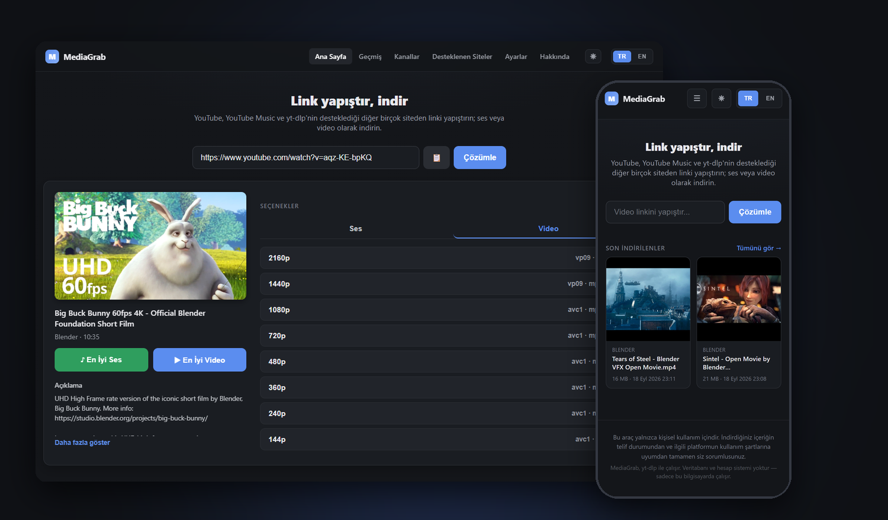

# MediaGrab

**[Latest Release: v2.4.0](https://github.com/umitkrkmz/mediagrab/releases/latest)** · **[Changelog](CHANGELOG.md)** · **[License](LICENSE)**

---

**Türkçe:** Link yapıştır, indir. Lokalde çalışan, kişisel kullanım için video/ses indirme aracı. YouTube, YouTube Music ve yt-dlp'nin desteklediği 1700'den fazla siteden (Vimeo, SoundCloud, Twitch vb.) ses/video indirir; veritabanı, hesap sistemi veya bulut bağlantısı yoktur.

**English:** Paste a link, download it. A local, personal-use video/audio downloader. Works with YouTube, YouTube Music, and 1700+ other sites yt-dlp supports (Vimeo, SoundCloud, Twitch, and more) — no database, account system, or cloud connection.

## Öne çıkanlar / Highlights

- **TR:** Ses/video indirme, playlist ve kanal takibi · indirme istatistikleri · telefondan kullanım (QR kodla) · Raspberry Pi'de 7/24 ev sunucusu · Docker desteği · Türkçe/İngilizce arayüz
- **EN:** Audio/video downloads, playlists and channel following · download statistics · use it from your phone (via QR code) · an always-on home server on a Raspberry Pi · Docker support · Turkish/English UI

## İndir / Download

### Windows

**[⬇ MediaGrabSetup.exe](https://github.com/umitkrkmz/mediagrab/releases/latest/download/MediaGrabSetup.exe)** — indirin, çalıştırın, bitti. Python, Git ya da ffmpeg kurmanız **gerekmez**; hepsi içinde gelir. Yönetici izni istemez. İndirdikleriniz `İndirilenler\MediaGrab` klasörüne kaydedilir (kurulumda ya da sonra Ayarlar'dan değiştirebilirsiniz). Kurulumda **"Docker ile kurulum"** seçeneği de var (ileri düzey, Docker Desktop gerekir).

**[⬇ MediaGrabSetup.exe](https://github.com/umitkrkmz/mediagrab/releases/latest/download/MediaGrabSetup.exe)** — download, run, done. **No** Python, Git or ffmpeg to install; everything comes with it. No admin rights needed. Downloads are saved to `Downloads\MediaGrab` (change it during setup or later in Settings). Setup also offers **"Install with Docker"** (advanced, needs Docker Desktop).

> **TR:** Önceki bir MediaGrab'ınız varsa yeni kurulum programı onu bulur; ayarlarınızı, kanallarınızı ve istatistiklerinizi aktarmayı, videolarınızı da yeni klasöre taşımayı teklif eder.
> **EN:** If you have an earlier MediaGrab, the new installer finds it and offers to bring over your settings, channels and statistics, and to move your videos into the new folder.

### Linux · macOS · Raspberry Pi

**TR:** Docker Compose ile (`ghcr.io/umitkrkmz/mediagrab`, amd64 ve arm64) ya da kaynak koddan. **EN:** With Docker Compose (`ghcr.io/umitkrkmz/mediagrab`, amd64 and arm64) or from source.

📖 **[Tam kılavuz — Türkçe](docs/README.tr.md)** · **[Full guide — English](docs/README.en.md)**

## Güvenli mi? / Is it safe?

**TR**

- **Kendi cihazınızda çalışır (self-hosted).** MediaGrab bir web sitesi ya da bulut hizmeti değil; kendi bilgisayarınızda ya da ev sunucunuzda (Raspberry Pi, mini PC) çalışan açık kaynak bir araç. İndirdikleriniz, ayarlarınız ve geçmişiniz o cihazda kalır.
- **Kurulum dosyasını bu sayfanın [Releases](https://github.com/umitkrkmz/mediagrab/releases) bölümünden alın.** Her sürüm burada, açık kaynak koddan otomatik olarak derlenir.
- **Reklam yok, ücret yok, hesap yok, telemetri yok.** MediaGrab kullanımınızı, indirme geçmişinizi ya da istatistiklerinizi hiçbir analiz hizmetine göndermez. Dışarıyla yalnızca işi için konuşur: istediğiniz içeriği indirirken ilgili siteyle (YouTube vb.), takip ettiğiniz kanalları denetlerken YouTube'la, Ayarlar'daki sürüm kontrollerinde de GitHub (MediaGrab) ve PyPI (yt-dlp ve bağımlılıklar) ile. Kaynak kodun tamamı burada, açık.
- **"Windows bilgisayarınızı korudu" uyarısı:** Kurulum programı tanınmış bir yayıncı imzası taşımadığı ve henüz yeterince indirilip "itibar" kazanmadığı için Windows ilk çalıştırmada bunu gösterebilir. Bu uyarı tek başına dosyanın zararlı olduğunu göstermez; güvenli olduğunu da kanıtlamaz. Devam etmeden önce dosyayı bu sayfanın Releases bölümünden aldığınızdan emin olun (isterseniz aşağıdaki gibi SHA256 değerini doğrulayın), sonra **Ek bilgi → Yine de çalıştır**'a tıklayın.
- **Doğrulamak isterseniz:** her yayının notlarında kurulum dosyasının SHA256 değeri ve VirusTotal tarama bağlantısı vardır. PowerShell'de `Get-FileHash .\MediaGrabSetup.exe` ile çıkan değeri karşılaştırın.

**EN**

- **It runs on your own device (self-hosted).** MediaGrab isn't a website or a cloud service; it's an open-source tool that runs on your own computer or home server (Raspberry Pi, mini PC). Your downloads, settings and history stay on that device.
- **Get the installer from this page's [Releases](https://github.com/umitkrkmz/mediagrab/releases).** Every version is built here, automatically, from the open-source code.
- **No ads, no payment, no account, no telemetry.** MediaGrab doesn't send your usage, download history or statistics to any analytics service. It only talks to the outside world to do its job: to the site you download from (YouTube etc.), to YouTube when it checks the channels you follow, and to GitHub (MediaGrab) and PyPI (yt-dlp and dependencies) for the version checks in Settings. All of its source code is right here.
- **"Windows protected your PC":** Windows may show this on first run because the installer isn't signed by a recognized publisher and hasn't built up a download "reputation" yet. The warning alone isn't proof that a file is harmful, and it doesn't prove that it's safe either. Before going on, make sure you got the file from this page's Releases (and, if you like, check its SHA256 as below), then click **More info → Run anyway**.
- **To verify it:** every release's notes list the installer's SHA256 and a VirusTotal scan link. In PowerShell, compare the output of `Get-FileHash .\MediaGrabSetup.exe`.

## Telefondan kullanın / Use it from your phone

**TR:** iPhone'da App Store indirme uygulamalarına izin vermiyor, kısayollar da sık bozuluyor. MediaGrab'ı bilgisayara kurun, telefonun tarayıcısından kullanın — uygulama yüklemeye gerek yok:

1. Bilgisayarda **Ayarlar → Uzaktan Erişim**'de bir parola belirleyip erişimi açın.
2. Çıkan QR kodu telefonun kamerasıyla okutun.
3. Link yapıştırın, indirin; dosya doğrudan telefonunuza iner.

**EN:** On iPhone, the App Store doesn't allow downloader apps and shortcuts break often. Install MediaGrab on a computer and use it from your phone's browser — nothing to install on the phone:

1. On the computer, set a password and turn access on in **Settings → Remote Access**.
2. Scan the QR code shown there with the phone's camera.
3. Paste a link and download; the file lands right on your phone.

## Lisans / License

**v1.0.0 – v1.8.0:** [MIT](LICENSE-MIT). **v1.9.0 ve sonrası / and later:** [GPL-3.0-or-later](LICENSE). Windows paketindeki üçüncü taraf yazılımlar (Python, FFmpeg ve Python paketleri) ve lisansları kurulum klasöründeki `THIRD-PARTY-NOTICES.txt` dosyasında ve uygulamanın Hakkında sayfasında listelenir. / The Windows package's third-party software (Python, FFmpeg and Python packages) and their licenses are listed in `THIRD-PARTY-NOTICES.txt` in the install folder and on the app's About page.

## Yasal Uyarı / Legal Notice

**TR:** Bu araç yalnızca kişisel kullanım içindir. İndirdiğiniz içeriğin telif durumundan ve ilgili platformun kullanım şartlarına uyumdan siz sorumlusunuz.

**EN:** This tool is for personal use only. You are solely responsible for the copyright status of downloaded content and compliance with the relevant platform's terms of service.

---

Projeyi faydalı bulduysanız ⭐ vermeniz, başkalarının da bulmasına yardımcı olur. · If you find MediaGrab useful, a ⭐ helps other people find it.
