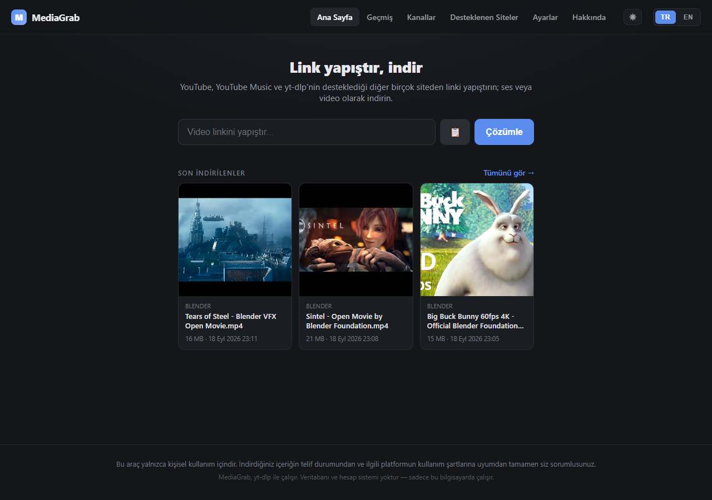
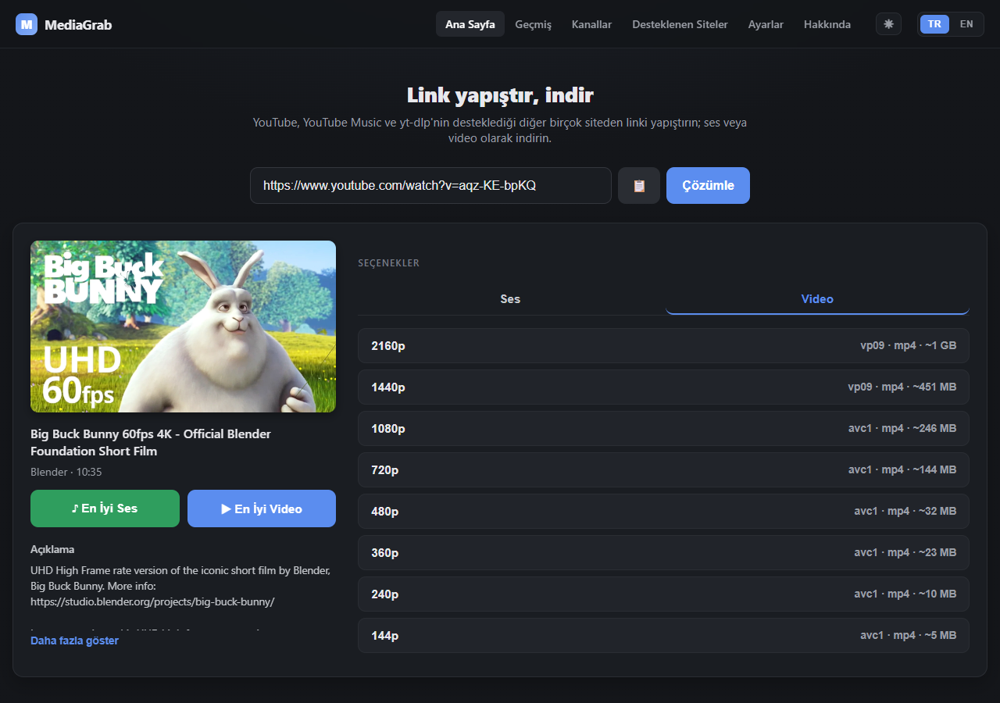
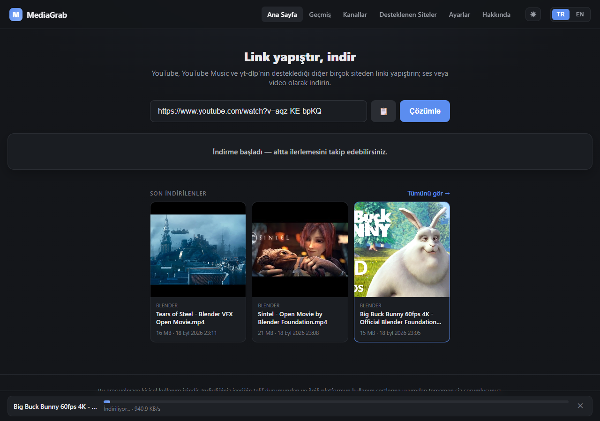
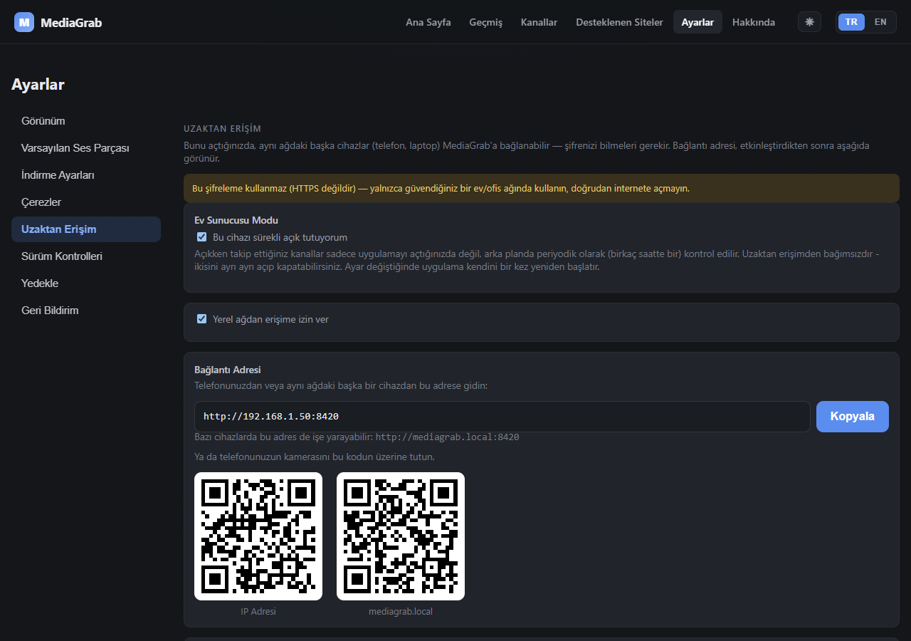
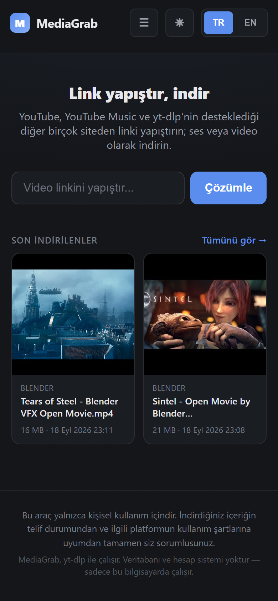
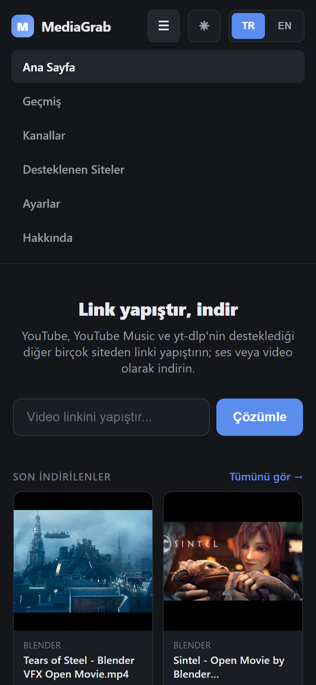
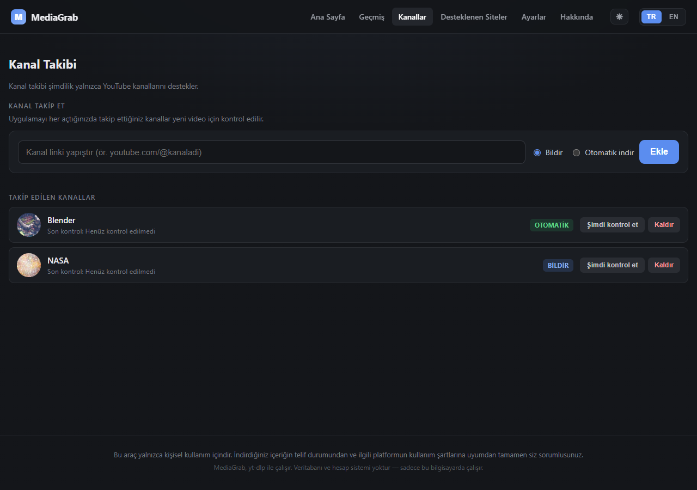
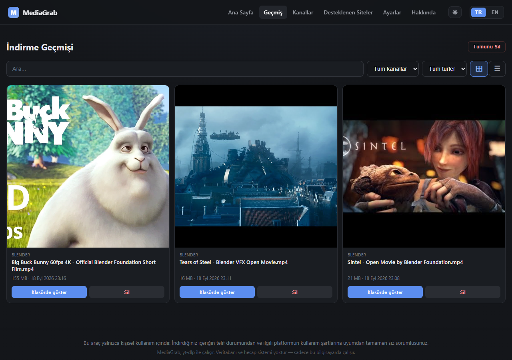

# MediaGrab — Kullanım Kılavuzu

**[🇬🇧 English version](README.en.md)** · **[← Ana README'ye dön](../README.md)**

---

**İçindekiler**

- [Hızlı başlangıç](#hızlı-başlangıç)
- [Ne yapar](#ne-yapar)
- [Örnek senaryolar](#örnek-senaryolar)
- [Özellikler](#özellikler)
- [Kurulum](#kurulum)
  - [Yöntem A: Windows kurulum programı (önerilen)](#yöntem-a-windows-kurulum-programı-önerilen)
  - [Yöntem B: Elle kurulum (her platform)](#yöntem-b-elle-kurulum-kaynak-koddan-her-platform)
  - [Yöntem C: Docker (her platform)](#yöntem-c-docker-her-platform)
- [Çalıştırma](#çalıştırma)
- [Kanal Takibi Nasıl Çalışır](#kanal-takibi-nasıl-çalışır)
- [Uzaktan Erişim (Yerel Ağdan)](#uzaktan-erişim-yerel-ağdan)
- [Ev Sunucusu Modu](#ev-sunucusu-modu)
- [Çerezler: yaş sınırlı ve giriş gerektiren videolar](#çerezler-yaş-sınırlı-ve-giriş-gerektiren-videolar)
- [Mobil Kullanım](#mobil-kullanım)
- [Testler](#testler)
- [Sorun Giderme](#sorun-giderme)
- [Proje yapısı](#proje-yapısı)
- [Lisans ve Üçüncü Taraf Bildirimleri](#lisans-ve-üçüncü-taraf-bildirimleri)
- [Yasal Uyarı](#yasal-uyarı)
- [yt-dlp güncel tutulmalı](#yt-dlp-güncel-tutulmalı)

---

Link yapıştır, indir. Lokalde çalışan, kişisel kullanım için video/ses indirme aracı.



## Hızlı başlangıç

| Yol | Kime uygun | Gerekenler |
|---|---|---|
| [Windows kurulum programı](#yöntem-a-windows-kurulum-programı-önerilen) | Windows'ta herkes | hiçbir şey |
| [Docker](#yöntem-c-docker-her-platform) | Linux, macOS, 7/24 açık bir makine (Raspberry Pi, mini PC) | Docker |
| [Elle kurulum](#yöntem-b-elle-kurulum-kaynak-koddan-her-platform) | Geliştiriciler, her platform | Git, Python, ffmpeg |

Kurulumdan sonra tarayıcıda `http://localhost:8420` açılır. Ayrıntılı adımlar aşağıdaki [Kurulum](#kurulum) bölümünde.

## Ne yapar

Bir YouTube veya YouTube Music linki (tekil video, playlist ya da albüm) yapıştırırsınız; MediaGrab linki çözümler, mevcut ses/video kalitelerini ve varsa altyazı dillerini listeler. Seçtiğiniz seçenek indirilir ve tarayıcıdan diskinize kaydedilir. YouTube dışında, yt-dlp'nin desteklediği diğer birçok site de (Vimeo, SoundCloud, X/Twitter, Twitch, archive.org vb. — [tam liste](https://github.com/yt-dlp/yt-dlp/blob/master/supportedsites.md)) aynı akıştan çalışır; kanal takibi özelliği ise şimdilik yalnızca YouTube kanallarını destekler.

## Örnek senaryolar

### 1. Bir videoyu ya da şarkıyı indirmek

1. Ana sayfadaki kutuya YouTube (veya desteklenen başka bir site) linkini yapıştırın — yapıştırır yapıştırmaz otomatik çözümlenir.
2. **Ses** ya da **Video** sekmesinden istediğiniz kaliteyi seçin (acele ediyorsanız "En iyi ses" / "En iyi video" tek tıkla iner).
3. İndirme, sayfanın altındaki panelde ilerler; bitince **Dosyayı indir**'e tıklayınca dosya bilgisayarınızda seçili şekilde açılır.





### 2. Bir playlist'i toplu indirmek

Playlist linkini yapıştırın; videolar kapak/başlık/süre ile listelenir. Birine tıklayıp tek tek indirebilir, ya da aralık seçip (ör. 1–19) **tümünü tek tıkla** kuyruğa atabilirsiniz.

### 3. Telefondan kullanmak

1. Bilgisayarda **Ayarlar → Uzaktan Erişim**'e gidin, bir şifre belirleyip "Yerel ağdan erişime izin ver"i açın.
2. Aynı panelde çıkan adresi ya da QR kodu telefonunuzun tarayıcısında açın.
3. Şifreyle giriş yapın; link yapıştırıp indirin, dosya doğrudan telefonunuza iner.



<p align="center">
  
  &nbsp;&nbsp;
  
</p>

### 4. Raspberry Pi'de 7/24 ev sunucusu

1. MediaGrab'ı [Docker](#yöntem-c-docker-her-platform) ile kurun.
2. **Ayarlar → Uzaktan Erişim → Ev Sunucusu Modu**'nu açın: takip listeniz siz uygulamayı açmasanız bile her 3 saatte bir kontrol edilir.
3. **Kanallar**'dan bir kanalı **Otomatik indir** modunda ekleyin; yeni videolar kendiliğinden iner. Depolama modunu **Cihaza Aktar** yaparsanız, bir dosya cihazınıza gönderildikten sonra Pi'deki kopya silinir.



### 5. Kurulumu başka bir bilgisayara taşımak

**Ayarlar → Yedekle → Dışa Aktar** tüm ayarlarınızı ve takip listenizi tek bir dosyaya kaydeder; yeni kurulumda **İçe Aktar** ile geri yüklersiniz. Uzaktan erişim şifreniz yedeğe dahil edilmez.

## Özellikler

### İndirme

- **Ses** — Opus / M4A (yeniden kodlanmadan, kalite kaybı yok) veya MP3 (evrensel uyumluluk için yeniden kodlanır)
- **Video** — mevcut tüm çözünürlükler, ses ile otomatik birleştirilmiş mp4 olarak; YouTube gerçek dosya boyutunu vermediğinde ortalama bit hızından tahmini boyut (`~1.2 GB`) gösterilir
- **Ses parçası (dublaj) seçimi, birden fazlası bir arada** — birden fazla dilde seslendirilmiş bir video için istediğiniz dili (veya videoyu `.mkv` olarak indirip birden fazla dili aynı anda, ör. orijinal + Türkçe) seçebilirsiniz; sadece gerçekten dublajı varsa görünür, hiçbirini seçmezseniz orijinal dil iner. Çoklu seçim yalnızca video indirmede geçerli, tekli seçim sesle de çalışır. `/settings`'ten bir varsayılan dil kaydedebilirsiniz — kanal otomatik indirmesi de bu ayarı kullanır (tek dil ile). Dil kodunu bilmiyorsanız [dil kodu sözlüğüne](language-codes.tr.md) bakabilirsiniz
- **Altyazı ve transkript** — elle eklenmiş altyazı dillerini işaretleyip seçtiğiniz videoyla birlikte, aynı dosya adıyla (`video.mp4` + `video.tr.srt`) indirir; medya oynatıcılar otomatik eşleştirir. Altyazısı (elle eklenmiş veya otomatik oluşturulmuş) olan videolar için düz metin transkripti (`.txt`) ayrıca indirebilirsiniz
- **Playlist & YouTube Music** — playlist linki yapıştırınca video listesi kapak/başlık/süre ile gelir; tek tek ya da aralık seçip tümünü tek tıkla kuyruğa atabilirsiniz
- **Çoklu platform** — YouTube'a özel değil; yt-dlp'nin desteklediği 1700'den fazla site (Vimeo, SoundCloud, X/Twitter, Twitch, archive.org vb.) aynı arayüzden çalışır. `/supported-sites` sayfasında popüler sitelerin kısa bir listesi var (her biri kendi marka rengiyle, tıklayınca sitenin ana sayfasına gider)
- **Meta veri (JSON) dışa aktarma** — her indirmeyle birlikte aynı dosya adıyla (`video.mp4` + `video.json`) başlık, kanal, yükleme tarihi, açıklama, etiketler ve kaynak linki gibi bilgileri içeren bir JSON dosyası kaydedilir
- **Otomatik klasörleme** — her indirme, kanal/yükleyici adına göre kendi alt klasörüne (`indirilenler/Kanal Adı/`) kaydedilir
- **İndirmeyi iptal etme ve var olan dosyayı koruma** — süren bir indirmeyi panelden durdurun (yarım dosyalar temizlenir); aynı videoyu tekrar indirirken iptal, hata veya çökme olursa eski dosyanız aynen geri gelir
- **İndirme hızı sınırlama ve disk alanı kalkanı** (`/settings`) — isteğe bağlı bir üst hız sınırı belirleyebilir; disk alanı bir indirmeyi bitirmeye yetmeyecek kadar azaldığında indirme baştan reddedilir
- **Çerez desteği** (`/settings`) — yaş sınırlı, üyelere özel veya giriş gerektiren içerik için hesabınızın çerezlerini kullanın: `cookies.txt` dosyasını Ayarlar'dan yükleyin (Docker dahil her kurulumda çalışır; yalnızca seçtiğiniz sitelerin çerezleri saklanır) ya da yerel kurulumda doğrudan tarayıcıdan okutun. Ayrıntılar: [Çerezler](#çerezler-yaş-sınırlı-ve-giriş-gerektiren-videolar)
- **Anlaşılır hata mesajları** — yaygın durumlar (yaş sınırı, bot koruması, coğrafi kısıtlama, kaldırılmış video vb.) için yt-dlp'nin ham çıktısı yerine açıklayıcı Türkçe/İngilizce mesajlar gösterilir

### Kullanım kolaylığı

- **Link yapıştır & hızlı seçenekler** — panodaki linki otomatik algılayan yapıştır butonu (yalnızca güvenli bağlamda, bkz. [Mobil Kullanım](#mobil-kullanım)); en iyi ses/en iyi video için tek tıkla hızlı indirme, diğer tüm kalite/format seçenekleri "gelişmiş seçenekler" altında
- **Kalıcı indirme paneli** — aynı anda birden fazla indirmeyi takip edin; hız yanında kalan tahmini süre de gösterilir; sayfa değiştirseniz veya uygulamayı kapatıp tekrar açsanız bile ilerleme durumu korunur
- **Kendi oynatıcısı** — indirme detay sayfasından ses/video dosyalarını dosya gezgini açmadan doğrudan oynatın. Tarayıcının kendi kontrolleri yerine sade, YouTube/Drive tarzı bir oynatıcı: ilerleme çubuğu, ses, oynatma hızı (0.5× – 2×), pencere içinde pencere ve tam ekran. Klavye kısayolları YouTube'la aynı: boşluk/K oynat-duraklat, ←/→ 5 sn, J/L 10 sn, ↑/↓ ses, M sessiz, F tam ekran, 0–9 videonun %0–90'ına atlama. Ses düzeyi ve hız hatırlanır
- **Otomatik dosya gezgini** — "Dosyayı indir"e tıklayınca dosya, işletim sisteminin dosya gezgininde seçili şekilde açılır. Docker'ı kendi bilgisayarınızda çalıştırıyorsanız (`localhost` ile, Chrome/Edge) bunun yerine **Klasöre Kaydet** çıkar: dosyayı istediğiniz klasöre kaydeden bir pencere açılır; iptal ederseniz hiçbir şey olmaz
- **Uygulama olarak yükleme (PWA)** — tarayıcının "Ana ekrana ekle" seçeneğiyle MediaGrab'ı bağımsız bir uygulama gibi kullanabilirsiniz
- **Mobil uyumlu arayüz** — küçük ekranlarda açılır menü, dokunmaya uygun büyüklükte butonlar, telefon ve tablette rahat kullanım
- **Açık / koyu tema ve Türkçe / İngilizce arayüz** — ikisi de sistem ayarını takip eder, elle de değiştirilebilir

### Kütüphane ve takip

- **İndirme geçmişi** (`/history`) — kapak resimli kart görünümü veya kompakt liste görünümü arasında geçiş yapılabilir; başlığa göre arama, kanala göre ve dosya türüne göre (diskteki gerçek uzantılardan otomatik oluşan) filtreleme, tekrar indirme, silme, tümünü silme. Bir dosyanın detay sayfasında dosyanın **gerçek** çözünürlüğü, kare hızı ve codec'leri yazar (ör. `1920×1080 (1080p) · 30 fps`, `Opus · 48 kHz · stereo`) — indirmeden önce hangi düğmeye basıldığına değil, dosyanın içinde ne olduğuna bakar



- **İstatistikler** (`/history` → İstatistikler sekmesi) — ne kadar, hangi siteden ve hangi biçimde indirdiğiniz: Günlük / Haftalık / Aylık görünüm, zamana göre indirmeler, siteler, ses biçimleri ve video çözünürlükleri, diskte MediaGrab'ın kapladığı yer ve boş alan. Her indirme bittiği anda sayılır, sonradan silinen dosyalar da sayılmaya devam eder; ilk açılışta mevcut indirmeler bir kez içe aktarılır. Yalnızca sayılar tutulur (site, tür, biçim, adet, boyut) — başlık, bağlantı, kanal ya da dosya adı kaydedilmez, her şey bu bilgisayarda kalır. "İstatistikleri Sıfırla" dosyalara dokunmaz
- **Kanal takibi** (`/channels`) — bir kanalı takibe alın; uygulamayı her açtığınızda yeni video var mı diye kontrol edilir. İki mod: **Bildir** (ana sayfada banner ile haber verir, siz seçersiniz) veya **Otomatik indir** (seçtiğiniz formatta kendiliğinden indirir). Sürekli arka planda çalışan bir servis değil (Ev Sunucusu Modu hariç) — bkz. [Kanal Takibi Nasıl Çalışır](#kanal-takibi-nasıl-çalışır)

### Erişim ve barındırma

- **Uzaktan erişim** (`/settings`) — bir şifre belirleyip açtığınızda, aynı Wi-Fi/ağdaki telefon veya başka bir bilgisayar tarayıcıdan MediaGrab'e bağlanıp kendi başına indirme yapabilir; detaylar için [Uzaktan Erişim](#uzaktan-erişim-yerel-ağdan) bölümüne bakın
- **Ev Sunucusu Modu** (`/settings`) — bir Raspberry Pi gibi 7/24 açık bir makinede çalıştıranlar için: periyodik (3 saatte bir) otomatik kanal kontrolü ve hatırlaması kolay `mediagrab.local` adresi; bkz. [Ev Sunucusu Modu](#ev-sunucusu-modu)
- **Docker desteği** — Python veya Git kurmadan, doğrudan bir container'da çalıştırabilirsiniz; Windows kurulum programındaki "Docker ile kurulum" seçeneğiyle, veya elle `docker compose up -d` ile — bkz. [Yöntem C](#yöntem-c-docker-her-platform)
- **Ayarları yedekle / içe aktar** (`/settings`) — tüm ayarlarınızı ve takip listenizi tek bir dosyaya (şifreniz hariç) dışa aktarıp başka bir kuruluma aktarabilirsiniz

### Bakım

- **MediaGrab güncelleme kontrolü** (`/settings`) — kurulu sürümü GitHub'daki son yayınla karşılaştırır; yeni sürüm varsa sürüm notlarına bağlantı ve kurulum türünüze göre (Docker, Windows kurulum programı, kaynak kod) doğru güncelleme adımlarını gösterir. Kendi kendini güncellemez. Kurulu sürüm `/about` sayfasında da yazar
- **yt-dlp sürüm kontrolü ve tek tıkla güncelleme** (`/settings`) — kurulu yt-dlp sürümünü PyPI'daki güncel sürümle karşılaştırır; güncelleme varsa tek tıkla kurar ve uygulamayı otomatik olarak yeniden başlatır
- **Ortam kontrolü** (`/settings`) — ffmpeg/ffprobe sürümü ve Python bağımlılıkları güncel mi diye kontrol edilir; paketler tek tıkla güncellenebilir
- **Geri bildirim ve Hakkında** — hata bildirmek veya özellik önermek için GitHub'daki hazır şablonlara tek tıkla gidin (`/settings`); "Tanılama bilgisini kopyala" düğmesi hata bildirimine yapıştırmanız için sürümleri, işletim sistemini, kurulum türünü ve çerez modunu tek metinde toplar (dosya yolu, IP adresi, bilgisayar adı veya çerez içeriği içermez); `/about` sayfasında proje, GPL-3.0 lisansı ve kaynak kod linkleri
- Veritabanı, hesap sistemi veya bulut bağlantısı **yok** — yalnızca bu bilgisayarda çalışır. Tek dış bağlantılar, Ayarlar → Sürüm Kontrolleri açıldığında yapılan sürüm sorgularıdır (GitHub ve PyPI); arka planda hiçbir şey gönderilmez

## Kurulum

Üç yol var: **Windows kurulum programı** (önerilen; Python, Git ya da ffmpeg gerekmez), **elle kurulum** (git clone + pip, her platformda çalışır) veya **Docker** (container içinde — Linux, macOS, Raspberry Pi ve Windows).

### Yöntem A: Windows kurulum programı (önerilen)

**1. İndirin:** [MediaGrabSetup.exe](https://github.com/umitkrkmz/mediagrab/releases/latest/download/MediaGrabSetup.exe) — her zaman son sürüm. Python, Git ya da ffmpeg kurmanız **gerekmez**: Python, ffmpeg ve Deno kurulum programının içinde gelir. Yönetici izni istemez.

İsterseniz dosyayı doğrulayın — her yayının notlarında o sürüme ait SHA256 değeri ve VirusTotal tarama bağlantısı yazar. PowerShell'de:

```powershell
Get-FileHash .\MediaGrabSetup.exe
```

**2. Çalıştırın.** Windows ilk seferde "Windows bilgisayarınızı korudu" diyebilir: kurulum programı ücretli bir kod imzası taşımıyor, Windows yayıncıyı henüz tanımıyor. **Ek bilgi → Yine de çalıştır** ile devam edin.

Kurulum Windows'un diline göre Türkçe ya da İngilizce açılır ve sırayla şunları sorar:

- **Kurulum türü** — *Normal kurulum* (önerilen) ya da *Docker ile kurulum* (ileri düzey, Docker Desktop gerekir — bkz. [Yöntem C](#yöntem-c-docker-her-platform)).
- **Önceki MediaGrab** — yalnızca v2.4.0'dan önceki kurulum aracıyla kurulmuş bir MediaGrab bulunursa çıkar. Ayarlarınız, kanallarınız, çerezleriniz ve istatistikleriniz yeni MediaGrab'a aktarılır; videolarınız yerinde kalır ve MediaGrab açılınca Geçmiş ile Ayarlar'da onları yeni klasöre taşımayı teklif eder. Eski kurulum silinmez.
- **Kurulum konumu** — varsayılan `%LOCALAPPDATA%\Programs\MediaGrab` (yalnızca program dosyaları).
- **İndirme klasörü** — varsayılan `İndirilenler\MediaGrab`. MediaGrab'ın kendi program klasörünün içi seçilemez (güncelleme ya da kaldırma oradaki dosyaları silebilir).

**3. Kullanın.** Kurulum bitince MediaGrab açılır ve tarayıcıda `http://localhost:8420` gelir. Saatin yanındaki bildirim alanında mavi **M** simgesi MediaGrab'ın çalıştığını gösterir: tıklayınca sayfayı açar, sağ tıklayıp **MediaGrab'ı kapat** ile kapatırsınız (Windows 11 yeni simgeleri `^` okunun altına saklayabilir). Daha sonra Başlat menüsünden ya da masaüstü kısayolundan açabilirsiniz.

**Nerede ne durur:**

| Ne | Nerede |
|---|---|
| Program | `%LOCALAPPDATA%\Programs\MediaGrab` |
| Ayarlar, kanallar, çerezler, istatistikler, günlük (`mediagrab.log`) | `%LOCALAPPDATA%\MediaGrab` |
| İndirdikleriniz | seçtiğiniz klasör (varsayılan `İndirilenler\MediaGrab`) |

İndirme klasörünü sonra **Ayarlar → İndirme Ayarları → İndirme Klasörü**'nden değiştirebilirsiniz (**Klasör Seç…** Windows'un klasör seçme penceresini açar). Değiştirdiğinizde yeni indirmeler yeni klasöre gider; eski klasördeki indirmeler için **Buraya taşı / Yerinde bırak** sorulur. Taşıma yalnızca MediaGrab'ın indirdiği dosyaları (ve `.json` bilgi dosyalarını) kanal klasörleriyle birlikte taşır, hiçbir dosyanın üzerine yazmaz; başka bir diske taşırken önce kopyalayıp boyutu doğrular, sonra eskisini siler.

**Güncelleme:** Yeni bir sürüm çıktığında **Ayarlar → Sürüm Kontrolleri** bunu gösterir. Yeni `MediaGrabSetup.exe`'yi indirip çalıştırın — açıksa MediaGrab'ı kendisi kapatır (önce sorar); ayarlarınız ve videolarınız korunur. yt-dlp'yi ise aradaki zamanda **Ayarlar → Sürüm Kontrolleri**'nden tek tıkla güncelleyebilirsiniz.

**Kaldırma:** Windows Ayarları → Uygulamalar → Yüklü uygulamalar → MediaGrab → Kaldır. Kaldırıcı verilerinize ne olacağını sorar:

- **Yalnızca MediaGrab'ı kaldır** (varsayılan) — ayarlar ve videolar kalır; yeniden kurunca her şey yerinde olur.
- **MediaGrab'ın ayarlarını da sil** — kanallar, çerezler ve istatistikler de silinir. Bunu seçince **İndirdiğim videoları da sil** kutusu da açılır; işaretlerseniz son bir kez onay ister ve yalnızca MediaGrab'ın indirdiği dosyaları siler — klasördeki başka dosyalarınıza dokunmaz.

### Yöntem B: Elle kurulum (kaynak koddan, her platform)

**1. Proje dosyalarını indirin**

```bash
git clone https://github.com/umitkrkmz/mediagrab.git
cd mediagrab
```

**2. Sanal ortam oluşturun ve etkinleştirin**

Bağımlılıkları sisteminize değil, projeye özel bir ortama kurmak için:

Windows (PowerShell):

```powershell
python -m venv .venv
.venv\Scripts\Activate.ps1
```

macOS / Linux:

```bash
python3 -m venv .venv
source .venv/bin/activate
```

İstem satırının başında `(.venv)` görünüyorsa ortam etkindir. Bundan sonraki tüm komutları bu ortam etkinken, aynı terminalde çalıştırın.

**3. Python bağımlılıklarını kurun**

```bash
pip install -r requirements.txt
```

**4. ffmpeg (sistem bağımlılığı — zorunlu)**

yt-dlp, remux/merge/encode işlemleri için; MediaGrab ise doğru medya süresini okumak için `ffprobe`'u sistem PATH'inden çağırır.

Windows:

```bash
winget install --id Gyan.FFmpeg -e
```

Kurulumdan sonra **yeni bir terminal** açın — PATH güncellemesi zaten açık olan terminalde görünmeyebilir.

macOS:

```bash
brew install ffmpeg
```

Linux (Debian/Ubuntu):

```bash
sudo apt install ffmpeg
```

Doğrulamak için: `ffmpeg -version`

### Yöntem C: Docker (her platform)

Python veya Git kurmadan, doğrudan bir Docker container'ında çalıştırabilirsiniz. Önce [Docker Desktop'ı kurun](https://www.docker.com/products/docker-desktop/) (veya Linux'ta Docker Engine + Compose plugin).

**Windows'ta kolay yol:** `MediaGrabSetup.exe`'yi çalıştırıp **Docker ile kurulum**'u seçin. Kurulum Docker Desktop'ın kurulu ve çalışır olduğunu denetler, bir klasör (varsayılan `C:\MediaGrab`) ve ilk parolayı sorar, `docker-compose.yml`'yi kendisi yazar, imajı indirip başlatır ve MediaGrab cevap verene kadar bekler — terminal komutu yazmanıza gerek kalmaz. Docker'da zaten bir MediaGrab varsa (eski kurulum aracıyla kurulmuş olanlar dahil) onu bulur, sürümünü gösterir ve parolanızla verilerinizi koruyarak yerinde günceller. Bu yolla kurulan Docker, kurulum programının sürümüne sabitlenmiş imajı kullanır (ör. `ghcr.io/umitkrkmz/mediagrab:2.4.0`); güncellemek için yeni kurulum programını çalıştırmanız yeterli. Kaldırınca konteyner silinir; verileriniz varsayılan olarak klasörde kalır.

**Elle (her platform):**

```bash
git clone https://github.com/umitkrkmz/mediagrab.git
cd mediagrab
```

Repodaki `docker-compose.yml` dosyasını açıp `MEDIAGRAB_INITIAL_PASSWORD`'ü gerçek bir şifreyle değiştirin — bu şifre yalnızca container ilk kez ayağa kalkarken, henüz bir şifre yokken kullanılır; sonrasında güvenle dosyada kalabilir, bir daha okunmaz. Linux'ta `network_mode: host` satırı varsayılan olarak açık (gerçek LAN IP'nin görünmesi ve `mediagrab.local` adresinin çalışması için gerekli); **Windows/Mac'te** Docker Desktop bunu desteklemediğinden o satırı yorum satırı yapıp altındaki `ports: ["8420:8420"]` satırlarını açın — **ve** hemen altındaki `MEDIAGRAB_HOST_LAN_IP` satırının yorumunu kaldırıp `ipconfig` (Windows) ile bulduğunuz gerçek LAN IP'nizi yazın; aksi halde Ayarlar sayfasındaki bağlantı adresi/QR kod, container'ın ulaşılamaz iç ağ adresini gösterir (Windows kurulum programının "Docker ile kurulum" seçeneği bunu sizin için otomatik yapar, elle kurulumda bu adım gerekli).

```bash
docker compose up -d
```

Repodaki compose dosyası yayımlanmış resmi imajı (`ghcr.io/umitkrkmz/mediagrab:latest`, amd64 ve arm64) kullanır; bu komut imajı ilk seferde indirir, derleme gerekmez. Başka bir cihazdan `http://<bu-bilgisayarın-LAN-IP'si>:8420` adresine gidin. İndirdikleriniz, ayarlarınız, takip listeniz, çerezleriniz ve istatistikleriniz `./data/` klasöründe, container'ın dışında kalıcı olarak saklanır — imaj yeniden derlense veya container yeniden oluşturulsa bile kaybolmaz.

**Güncelleme:** Yeni bir sürüm çıktığında Ayarlar → Sürüm Kontrolleri bunu gösterir. `docker-compose.yml`'in bulunduğu klasörde:

```bash
docker compose pull && docker compose up -d
```

Ayarlarınız, çerezleriniz, istatistikleriniz ve indirdikleriniz `./data/` klasöründe kaldığı için kaybolmaz. yt-dlp'yi ayrıca Ayarlar sayfasından tek tıkla güncelleyebilirsiniz (kalıcı bir klasöre kurulur, imaj yenilense bile kaybolmaz); diğer tüm bağımlılıklar (FastAPI, ffmpeg, Deno vb.) imaja gömülüdür ve imajla birlikte güncellenir.

> **Eski bir kurulumunuz varsa:** v2.2.0'dan önce repodan elle kurduysanız compose dosyanızda `image:` yerine `build: .` satırı olabilir. O satırı `image: ghcr.io/umitkrkmz/mediagrab:latest` ile değiştirin, sonra yukarıdaki komutu kullanın. Kendi değişikliklerinizle yerel derleme yapmak isterseniz `build: .` kullanıp `docker compose up -d --build` çalıştırabilirsiniz. Windows kurulum programının "Docker ile kurulum" seçeneği zaten yayınlanmış imajı kullanır.
>
> **v2.3.0'dan önce kurduysanız:** compose dosyanızın `volumes:` bölümüne `- ./data/stats:/data/stats` satırını ekleyin; eklemezseniz istatistikler çalışır ama container yeniden oluşturulunca sıfırlanır. (v2.2.0'dan önceki kurulumlar için `- ./data/cookies:/data/cookies` satırı da gerekir.)

Ayarlar sayfasındaki "bağımlılıkları güncelle" düğmesi Docker'da devre dışıdır ve bunu size hatırlatır — kendisi imaj güncellemesi/derlemesi yapamaz.

## Çalıştırma

> **Windows kurulum programıyla kurduysanız** bu bölüm sizin için değil: MediaGrab'ı Başlat menüsünden açın, bildirim alanındaki **M** simgesinden kapatın. Aşağısı kaynak koddan ([Yöntem B](#yöntem-b-elle-kurulum-kaynak-koddan-her-platform)) çalıştıranlar içindir.

Sanal ortam etkinken, proje kök dizininden:

```bash
python run.py
```

Bu, sunucuyu başlatır ve tarayıcınızı otomatik olarak açar (varsayılan port 8420). Durdurmak için terminalde `Ctrl+C`.

Alternatif olarak, `uvicorn`'u doğrudan da çalıştırabilirsiniz:

```bash
uvicorn mediagrab.app:app --port 8420
```

Bu durumda tarayıcıda `http://127.0.0.1:8420` adresini elle açmanız gerekir.

> **Port çakışması:** 8000/3000/5000/8080 gibi "standart" portlar başka projelerle çakışabildiği için varsayılan 8420 seçildi. Ama `python run.py` ile çalıştırırsanız bununla da sınırlı değilsiniz: 8420 doluysa önce orada gerçekten MediaGrab çalışıp çalışmadığını kontrol eder — öyleyse aynı sekmeyi açar, değilse (başka bir projeniz o portu tutuyorsa) işletim sisteminden otomatik olarak boş bir port bulup onu kullanır. `uvicorn` komutunu doğrudan çalıştırırsanız bu otomatik davranış devreye girmez, çakışma durumunda `--port` ile elle farklı bir port seçmeniz gerekir.

## Kanal Takibi Nasıl Çalışır

MediaGrab sürekli arka planda çalışan bir servis **değil** — sadece siz açtığınızda çalışır. Bu yüzden kanal takibi de "her açılışta bir kez kontrol et" mantığıyla çalışır: uygulamayı başlattığınızda (`python run.py` veya `uvicorn` komutunu çalıştırdığınızda), takip listenizdeki tüm kanallar arka planda kontrol edilir. Uygulama kapalıyken yeni yüklenen videolar, siz tekrar açana kadar tespit edilmez — kişisel/lokal bir araç için beklenen davranış budur; 7/24 arka planda çalışan bir Windows servisi haline getirmek istemiyoruz.

Takip listesi ve son görülen video bilgisi, veritabanı yerine `channels.json` dosyasında (git'e dahil değil) tutulur — projenin geri kalanıyla aynı "gerçek veri diskte, ayrı bir DB yok" felsefesi.

## Uzaktan Erişim (Yerel Ağdan)

MediaGrab'ı bir bilgisayarda çalıştırıp aynı Wi-Fi/ağdaki telefonunuzdan veya başka bir cihazdan tarayıcıyla açabilirsiniz — MediaGrab'ı her cihaza ayrı ayrı kurmanıza gerek kalmaz.

**Nasıl açılır:** `/settings` → **Uzaktan Erişim** sekmesi → önce bir şifre belirleyin, sonra "Yerel ağdan erişime izin ver" seçeneğini açın. Ayar uygulanırken sunucu kendini bir kez yeniden başlatır; işlem bitince aynı panelde bağlantı adresi (`http://192.168.x.x:8420` gibi) görünür — bu adresi diğer cihazın tarayıcısına yazmanız yeterli. İlk açılışta o cihaz da şifreyle giriş yapar.

- **Bağlı cihazlar** — aynı panelde o an oturum açmış her cihazı (tarayıcı + işletim sistemi tahmini, ör. "Chrome · Windows") ve bağlantı zamanını görürsünüz; istediğiniz birini tek başına çıkışa zorlayabilirsiniz, kendi cihazınız etkilenmez.
- **Şifre değiştirme** — mevcut şifre / yeni şifre / yeni şifre (tekrar) ile değiştirilir. Şifreyi unutursanız: bu bilgisayardaki `settings.json` dosyasından `remote_access_password_salt` ve `remote_access_password_hash` alanlarını silip MediaGrab'ı yeniden başlatın, ayarlar sayfasından yeni bir şifre belirleyebilirsiniz. Şifre her değiştiğinde (veya bu kurtarma yoluyla sıfırlandığında), değiştiren dahil oturum açmış her cihaz otomatik çıkışa zorlanır.
- **Depolama modu** — **Bende Kalsın** (varsayılan): indirilen dosyalar her zamanki gibi bu bilgisayarda `indirilenler/` klasöründe kalıcı olarak durur; kişisel bilgisayar için önerilen mod. **Cihaza Aktar**: depolaması sınırlı bir cihazda (ör. Raspberry Pi) çalıştırıyorsanız, telefon gibi başka bir cihaz bir dosyayı tamamen indirdikten sonra bu bilgisayardaki kopyası silinir. Kendi bilgisayarınızdan (host'un kendi tarayıcısından) yaptığınız indirmeler bu ayardan etkilenmez ve hiçbir zaman kendiliğinden silinmez. Docker'ı kendi bilgisayarınızda `localhost` ile açtıysanız **Klasöre Kaydet** çıkar; bu durumda kopya yalnızca dosya seçtiğiniz klasöre gerçekten kaydedildikten sonra silinir, pencereyi iptal ederseniz dosyaya dokunulmaz. Bilinen sınır: başka bir bilgisayarın tarayıcısı "her dosyanın nereye kaydedileceğini sor" ayarıyla açıksa, tarayıcı dosyayı pencere açıkken indirdiği için iptal algılanamaz.

> **Güvenlik notu:** Bu bağlantı düz HTTP üzerinden çalışır (HTTPS değildir) — yalnızca güvendiğiniz bir ev/ofis ağında kullanın, yönlendirici (router) ayarlarından doğrudan internete açmayın. Oturumlar bellekte tutulur; sunucu yeniden başladığında (güncelleme, bilgisayarın kapanması vb.) herkes tekrar şifreyle giriş yapmalıdır — bu bilinçli bir sadeleştirme, kişisel/lokal bir araç için diskte kalıcı oturum tutmaya gerek görülmedi.

## Ev Sunucusu Modu

Normalde MediaGrab yalnızca siz açtığınızda çalışır ve kanal takibini de o anda, bir kez kontrol eder (bkz. yukarıdaki "Kanal Takibi Nasıl Çalışır"). Bir Raspberry Pi gibi 7/24 açık bir makinede çalıştırıyorsanız, `/settings` → **Uzaktan Erişim** sekmesindeki **Ev Sunucusu Modu**'nu açarak bunu değiştirebilirsiniz:

- **Periyodik kanal kontrolü** — takip listeniz, siz uygulamayı açmasanız bile her 3 saatte bir otomatik olarak kontrol edilir; "Otomatik indir" modundaki kanallar yeni video çıkar çıkmaz (bir sonraki kontrolde) indirilmeye başlar.
- **`mediagrab.local` adresi** — LAN IP'nize (`http://192.168.x.x:8420`) ek olarak, aynı ağdaki cihazlardan hatırlaması kolay `http://mediagrab.local:8420` adresiyle de erişebilirsiniz (mDNS/Bonjour destekleyen işletim sistemlerinde — Windows, macOS, çoğu Linux dağıtımı çalışır; Docker'da yalnızca Linux'ta `network_mode: host` ile çalışır, Windows/Mac Docker Desktop'ta çalışmaz). Ayarlar sayfasında IP ve bu adres için ayrı ayrı, hangisinin hangisi olduğu etiketli iki QR kod görürsünüz — telefonunuzla okutup direkt açabilirsiniz.

Ev Sunucusu Modu, Uzaktan Erişim'den bağımsız bir ayardır: birini açıp diğerini kapalı bırakabilir, ya da ikisini birlikte kullanabilirsiniz.

## Çerezler: yaş sınırlı ve giriş gerektiren videolar

Bazı videolar yalnızca giriş yapmış bir hesapla izlenebilir: yaş sınırlı videolar, kanal üyelerine özel içerik, gizli videolar, bazen de YouTube'un "bot olmadığınızı doğrulayın" engeli. MediaGrab bunları hesabınızın çerezleriyle indirebilir. Böyle bir hata aldığınızda ana sayfadaki mesajın altında doğrudan **Ayarlar → Çerezler** bağlantısı çıkar.

> **Hesabınız için uyarı:** yt-dlp'nin kendi belgelerine göre, hesap çerezleriyle yapılan yoğun indirmeler hesabın geçici veya kalıcı olarak kısıtlanmasına yol açabilir. Mümkünse ikincil bir hesap kullanın ve çerezleri yalnızca erişim hakkınız olan içerik için kullanın.

### cookies.txt nasıl alınır (önerilen yol)

1. Tarayıcınıza açık kaynaklı **Get cookies.txt LOCALLY** eklentisini kurun ([Chrome / Edge](https://chromewebstore.google.com/detail/cclelndahbckbenkjhflpdbgdldlbecc) · [Firefox](https://addons.mozilla.org/firefox/addon/get-cookies-txt-locally/)). yt-dlp de bu eklentiyi öneriyor. Adında "LOCALLY" olmayan eski "Get cookies.txt" eklentisi zararlı çıkmıştı, onu kurmayın.
2. Eklenti ayarlarından gizli (özel) pencerede çalışmasına izin verin. Sonra gizli bir pencere açıp youtube.com'da hesabınıza giriş yapın.
3. Aynı sekmede `youtube.com/robots.txt` adresini açın ve eklentide **Export**'a basın. **Export All Cookies**'e basmayın, o tarayıcıdaki bütün sitelerin çerezlerini alır.
4. Gizli pencereyi kapatın.

Neden gizli pencere? YouTube, açık sekmelerdeki oturum çerezlerini güvenlik için sık sık yeniler. Normal bir pencereden alınan çerezler bu yüzden kısa sürede geçersiz kalabilir; kapatılmış bir oturumun çerezleri çok daha uzun geçerli kalır. Yöntem, yt-dlp'nin [YouTube çerezleri rehberinden](https://github.com/yt-dlp/yt-dlp/wiki/Extractors#exporting-youtube-cookies) alındı.

### MediaGrab'a yükleme

Ayarlar → Çerezler → **cookies.txt dosyası** seçeneğinde dosyayı seçin. MediaGrab dosyayı okur ve içindeki siteleri listeler: YouTube ve Google işaretli gelir, diğer her şey işaretsizdir. **Seçilenleri kaydet**'e bastığınızda yalnızca işaretli sitelerin çerezleri kaydedilir, gerisi diske hiç yazılmaz. Yanlışlıkla "Export All" dosyası yüklerseniz bile bankanızın ya da e-postanızın oturumu MediaGrab'a girmez.

Kayıttan sonra bir özet görünür: kaç site ve çerez olduğu, ne zaman yüklendiği, son güncelleme zamanı ve dosyada **YouTube oturumu olup olmadığı**. "YouTube oturumu görünmüyor" uyarısı çıkarsa ya dışa aktarırken giriş yapılmamıştır ya da oturum artık geçersizdir; yeni bir dosya alın. **Bağlantıyı sına** çerezlerin okunabildiğini doğrular, **Çerezleri sil** dosyayı kaldırıp çerez kullanımını kapatır.

- **Docker'da** dosya `./data/cookies/` klasöründe tutulur ve container yeniden oluşturulsa bile kalır. Bu özellikten önce kurulmuş bir Docker kurulumunda `docker-compose.yml`'in `volumes:` bölümüne şu satırı ekleyin, yoksa yüklenen dosya container yenilenince kaybolur:
  ```yaml
      - ./data/cookies:/data/cookies
  ```
  Windows kurulum programının "Docker ile kurulum" seçeneğiyle yapılan kurulumlar ve repodaki compose dosyası bu satırı zaten içerir. Docker'da "Tarayıcıdan" seçeneği yoktur, çünkü container'ın içinde bir tarayıcı yoktur.
- **Yerel kurulumda** dosya `settings.json`'ın yanında `cookies.txt` olarak durur (Windows kurulum programında `%LOCALAPPDATA%\MediaGrab`, kaynak koddan kurulumda proje klasörü) ve git'e dahil değildir.

### Gizlilik ve güvenlik

- Dosya yalnızca bu cihazdaki MediaGrab veri klasörüne kaydedilir. Hiçbir yere gönderilmez ve Ayarlar → Yedekle dosyasına girmez.
- Arayüz ve API çerezlerin adını ya da değerini hiçbir zaman göstermez, yalnızca site ve sayı özeti döner.
- Linux'ta ve Docker'da dosya yalnızca sahibinin okuyabileceği izinle (`600`) yazılır.
- yt-dlp, indirme sırasında YouTube'un yenilediği çerezleri bu dosyaya geri yazar; "son güncelleme" zamanı bu yüzden ilerler. Bir indirme sürerken yeni bir dosya yüklerseniz, biten indirme yeni yüklemenin üzerine yazmaz.

### Diğer yollar

- **Tarayıcıdan (yalnızca yerel kurulum):** MediaGrab çerezleri doğrudan tarayıcınızdan okur. **Windows'ta yalnızca Firefox listelenir**: Chrome, Edge, Brave gibi Chromium tabanlı tarayıcıların çerezlerini Windows'ta Chrome 127'den beri yalnızca tarayıcının kendisi çözebiliyor (App-Bound Encryption), üstelik bu durumda her indirme hata veriyordu. Bu tarayıcılarda cookies.txt yolunu kullanın. macOS'ta ve Linux'ta Chrome ve diğerleri de listelenir. Daha önce Windows'ta Chrome seçmişseniz çerezler yok sayılır (indirmeler bozulmaz) ve Ayarlar bunu bir uyarıyla gösterir.
- **Dosya yolu (gelişmiş, yalnızca yerel kurulum):** Bilgisayardaki bir cookies.txt dosyasının yolunu yazabilirsiniz. MediaGrab bu dosyayı hiçbir zaman silmez.

### Çerez ayarlıyken hâlâ inmiyorsa

- **"YouTube çerezleriniz artık geçersiz"**: YouTube oturumu yenilemiş. Gizli pencere yöntemiyle yeni bir cookies.txt alıp yükleyin.
- **"YouTube bu hesap için yaş doğrulaması istiyor"** (hata ya da seçeneklerin üstünde sarı uyarı; o durumda Opus/M4A devre dışı görünür ve yalnızca düşük kaliteli biçim gelir): Çerezleriniz çalışıyor, ama YouTube bu hesap için onay istiyor. Önce videoyu YouTube'da aynı hesapla açıp içerik uyarısını onaylayın ("içeriği göster") ve tekrar deneyin; bu bir kullanıcıda sorunu çözdü. Olmazsa hesabın yaşını YouTube/Google'dan doğrulayın. Yeni bir cookies.txt bunu çözmez. yt-dlp'nin kaynak kodundaki nota göre bu özellikle AB ülkelerinde görülüyor.
- **Ayarlar → Sürüm Kontrolleri'nde "JavaScript çalışma ortamı: Eksik"**: yt-dlp, YouTube'un korumalarını çözmek için Deno'ya ihtiyaç duyar. O olmadan yaş sınırlı videolar çerezle bile inmeyebilir. "Şimdi Güncelle" ile kurulur; Docker'da imajı güncelleyin.

## Mobil Kullanım

MediaGrab'ı telefondan ya da tabletten, [Uzaktan Erişim](#uzaktan-erişim-yerel-ağdan) ile açtığınızda arayüz küçük ekrana uyum sağlar:

- **Açılır menü** — dar ekranda üst menü ve Ayarlar sayfasının kategori listesi, ☰ simgesiyle açılıp kapanan dikey birer liste olur; bir kategori seçince menü kendiliğinden kapanır.
- **Dokunmaya uygun butonlar** — küçük simge butonları (menü, tema, dil) telefonda büyütülür.
- **Yapıştır butonu neden yok?** Tarayıcılar panoyu okuma API'sini yalnızca güvenli bağlamda (HTTPS veya `localhost`) açar. Uzaktan erişim düz HTTP üzerinden çalıştığı için telefonda o buton çalışamaz, bu yüzden gösterilmez. Link alanına **uzun basıp "Yapıştır"**ı seçmeniz yeterli — yapıştırır yapıştırmaz link yine otomatik çözümlenir.
- **`mediagrab.local` bazen açılmıyor** — özellikle Android tarayıcılarında `.local` adreslerinin çözümlenmesi güvenilir değildir (Android'in kendi kısıtı). Böyle bir durumda Ayarlar'daki **IP adresini** (veya onun QR kodunu) kullanın; o her zaman çalışır.

## Testler

Ağ erişimi gerektirmeyen, birkaç saniyede biten bir test paketi var (yol güvenliği, VTT/transkript ayrıştırma, sürüm karşılaştırma, yedekle-geri-yükle, çeviri bütünlüğü, arayüzdeki HTML kaçışı).

```bash
pip install -r requirements-dev.txt
pytest
```

JavaScript testleri için Node.js kurulu olmalı; değilse o testler otomatik atlanır.

Testler GitHub'da `master`'a her push'ta otomatik olarak da çalışır (Actions → "Tests"). Docker imajı için ayrı bir duman testi var — imajı başlatıp giriş, ffmpeg/ffprobe/Deno, Geçmiş ve istatistikleri dener:

```bash
docker build -t mediagrab:dev .
bash .github/scripts/smoke-docker.sh mediagrab:dev 8422
```

## Sorun Giderme

**Windows kurulum programıyla kurdum, MediaGrab açılmıyor**
Önce bildirim alanında mavi **M** simgesi var mı bakın (Windows 11'de `^` okunun altında olabilir) — varsa MediaGrab çalışıyordur, simgeye tıklayın. Bir hata kutusu çıktıysa ya da hiçbir şey olmuyorsa ayrıntılar `%LOCALAPPDATA%\MediaGrab\mediagrab.log` dosyasındadır; hata bildirirken bu dosyayı ekleyin.

**`ModuleNotFoundError` veya "paket bulunamadı" hatası**
Sanal ortamın etkin olduğundan emin olun (istem başında `(.venv)` görünmeli), sonra `pip install -r requirements.txt`'i tekrar çalıştırın.

**`ffmpeg`/`ffprobe` bulunamadı hatası**
ffmpeg'i kurduktan sonra **yeni bir terminal** açtığınızdan emin olun — PATH güncellemesi zaten açık olan terminalde görünmez. `ffmpeg -version` ile doğrulayın.

**`[Errno 10048] ... address already in use` / port 8420 dolu hatası**
`python run.py` ile çalıştırıyorsanız bu durum kendiliğinden çözülür (bkz. yukarıdaki port çakışması notu). `uvicorn` komutunu doğrudan kullanıyorsanız: muhtemelen önceki bir MediaGrab örneği hâlâ arka planda çalışıyor, ya da başka bir projeniz aynı portu kullanıyor — `--port` ile farklı bir port seçin.

Windows'ta hangi sürecin portu tuttuğunu bulup kapatmak için:

```powershell
Get-NetTCPConnection -LocalPort 8420 | Select-Object OwningProcess
Stop-Process -Id <yukarıdaki PID> -Force
```

**Telefonda "Panodan yapıştır" butonu yok**
Bu bilinçli: tarayıcılar, düz HTTP üzerinden (uzaktan erişim) açılan sayfalarda panoyu okumaya izin vermez. Link alanına uzun basıp "Yapıştır"ı seçin; link yine otomatik çözümlenir. Ayrıntılar için bkz. [Mobil Kullanım](#mobil-kullanım).

**`mediagrab.local` telefonda (özellikle Android'de) açılmıyor**
Android tarayıcılarında `.local` çözümlemesi güvenilir değildir. Ayarlar → Uzaktan Erişim'deki IP adresini (veya QR kodunu) kullanın. Docker'da (Windows/Mac) `mediagrab.local` zaten hiç çalışmaz, bkz. [Ev Sunucusu Modu](#ev-sunucusu-modu).

**`ImportError: attempted relative import with no known parent package`**
`mediagrab/app.py`'yi doğrudan `python app.py` ile çalıştırmayın; her zaman proje kök dizininden `uvicorn mediagrab.app:app` kullanın — aksi halde paket içi göreli importlar çalışmaz.

**Yaş sınırlı veya giriş gerektiren bir video inmiyor**
Ana sayfadaki hata mesajının altındaki **Ayarlar → Çerezler** bağlantısını izleyin; adımlar ve çerez ayarlıyken hâlâ inmeyen durumlar için bkz. [Çerezler](#çerezler-yaş-sınırlı-ve-giriş-gerektiren-videolar).

**yt-dlp bir videoyu çözemiyor / "Unable to extract" hatası**
YouTube arayüzünü değiştirdiğinde eski yt-dlp sürümleri bozulur. Güncelleyin:

```bash
pip install -U "yt-dlp[default,deno]"
```

## Proje yapısı

```
mediagrab/
    app.py          # FastAPI uygulaması, endpoint'ler
    downloader.py   # yt-dlp sarmalayıcı — yt_dlp importu SADECE burada
    models.py       # Pydantic modelleri
    i18n.py         # sunucuda basılan arayüz metinleri (TR/EN) — tek kaynak
    deps.py         # ffmpeg/ffprobe ve Python paket sürüm kontrolleri
    store.py        # channels.json / settings.json / stats.json okuma-yazma, DB değil
    stats.py        # indirme istatistikleri: sınıflandırma, ilk içe aktarma, gün/hafta/ay özeti
    paths.py        # program/veri/indirme klasörlerini kurulum türüne göre çözer
    mover.py        # indirme klasörü değişince eski indirmeleri taşıma
    tray.py         # Windows bildirim alanı simgesi (yalnızca Windows kurulumu)
    folder_picker.py  # Windows'un klasör seçme penceresi
    uninstall.py    # Windows kaldırıcısının "videoları da sil" yardımcısı
    templates/      # Jinja2: base, index, history, item, channels, settings, supported_sites, about
    static/         # style.css, app.js
    static/icons/   # desteklenen site logoları (Simple Icons'tan, yerelde tutulur)
indirilenler/       # indirilen dosyalar, kanal adına göre alt klasörlenir (git'e dahil değil)
    Kanal Adı/
        Video.mp4
        Video.json  # meta veri sidecar dosyası
channels.json       # takip edilen kanallar (git'e dahil değil)
settings.json       # çerez ve varsayılan ses dili ayarları (git'e dahil değil)
cookies.txt         # Ayarlar → Çerezler'den yüklenen dosya (git'e dahil değil; Docker'da ./data/cookies/)
stats.json          # indirme istatistikleri, yalnızca sayılar (git'e dahil değil; Docker'da ./data/stats/)
run.py              # `python run.py` ile çalıştırmak için giriş noktası
packaging/          # Windows kurulum programı: build_windows.py (gömülü Python + paketler + ffmpeg), mediagrab.iss ve yardımcı .iss'ler (Inno Setup), exe_branding.py, mediagrab.ico
Dockerfile          # Docker imajı (python:3.12-slim + ffmpeg)
docker-compose.yml  # örnek compose dosyası (elle Docker kurulumu için)
.dockerignore
tests/              # pytest paketi (ağ gerektirmez)
docs/               # bu dosya, İngilizce karşılığı, dil kodu sözlüğü (language-codes.*.md) ve ekran görüntüleri (images/)
maps/               # ayrıntılı proje haritası ve rota haritası (test-korumalı, AI araçları ve katkıcılar için)
requirements.txt
requirements-dev.txt  # yalnızca geliştirme (pytest) — uygulama bunu okumaz
LICENSE             # v1.9.0+ (GPL-3.0-or-later)
LICENSE-MIT         # v1.0.0 – v1.8.0 (MIT)
README.md
```

## Lisans ve Üçüncü Taraf Bildirimleri

**MediaGrab v1.0.0 – v1.8.0** sürümleri **MIT** lisansıyla yayınlandı (bkz. [LICENSE-MIT](../LICENSE-MIT)) ve bu hak geriye dönük değişmez — o sürümleri MIT şartlarıyla kullanmaya, fork'lamaya devam edebilirsiniz.

**MediaGrab v1.9.0 ve sonrası GNU GPL-3.0 (veya sonrası)** ile lisanslanmıştır (bkz. [LICENSE](../LICENSE)). Geçişin sebebi basit: `mutagen` gibi GPL lisanslı bir bağımlılığı MIT kalarak kullanmak, onu hiç doğrudan `import` etmemeyi ve yalnızca yt-dlp'nin arka planda, ayrı bir süreç olarak çalıştırmasına güvenmeyi gerektiriyordu (aşağıda anlatılıyor). GPL-3.0'a geçmek bu kısıtı ortadan kaldırıyor — ileride bir özellik gerçekten GPL lisanslı bir kütüphaneyi doğrudan kullanmak isterse, bunu MIT'te olduğu gibi dolambaçlı bir savunmaya ihtiyaç duymadan yapabiliriz. AGPL gibi daha kısıtlayıcı bir lisans yerine GPL-3.0 seçildi çünkü MediaGrab bir ağ servisi olarak sunulmuyor, yalnızca yerelde çalışan bir araç.

**Kaynak koddan kurulumda** (Yöntem B) kullanıcı repoyu klonlar, `pip install -r requirements.txt` ile bağımlılıkları kendi ortamına kurar ve çalıştırır; aşağıdaki paketlerin hiçbiri MediaGrab ile birlikte paketlenmez — hepsini `pip` kendi indirir.

**Windows kurulum programı (v2.4.0'dan itibaren) ise bir dağıtımdır:** içinde Python 3.14 (gömülü paket, PSF lisansı), FFmpeg (yt-dlp/FFmpeg-Builds'in GPL derlemesi), Deno ve aşağıdaki Python paketleri birlikte gelir. Her birinin lisans metni pakette kendi yanında durur; hepsinin listesi, sürümleri, lisansları ve kaynak bağlantıları kurulum klasöründeki `THIRD-PARTY-NOTICES.txt` dosyasında ve uygulamanın **Hakkında** sayfasındadır. FFmpeg GPL lisanslı olduğu için her yayının ek dosyalarında o sürümde kullanılan FFmpeg'in kaynak kodu ve derleme betikleri de bulunur. Docker imajı da benzer şekilde Python paketlerini ve Debian'ın ffmpeg paketini içerir.

| Paket | Lisans | Not |
|---|---|---|
| [`yt-dlp`](https://github.com/yt-dlp/yt-dlp) | [Unlicense](https://github.com/yt-dlp/yt-dlp/blob/master/LICENSE) (kamu malı) | indirme/çözümleme motoru |
| [`fastapi`](https://github.com/fastapi/fastapi) | [MIT](https://github.com/fastapi/fastapi/blob/master/LICENSE) | web çatısı |
| [`starlette`](https://github.com/encode/starlette) | [BSD-3-Clause](https://github.com/encode/starlette/blob/master/LICENSE.md) | fastapi'nin ASGI katmanı |
| [`uvicorn`](https://github.com/encode/uvicorn) | [BSD-3-Clause](https://github.com/encode/uvicorn/blob/master/LICENSE.md) | ASGI sunucusu |
| [`pydantic`](https://github.com/pydantic/pydantic) | [MIT](https://github.com/pydantic/pydantic/blob/main/LICENSE) | veri doğrulama |
| [`jinja2`](https://github.com/pallets/jinja) | [BSD-3-Clause](https://github.com/pallets/jinja/blob/main/LICENSE.txt) | HTML şablonlama |
| [`mutagen`](https://github.com/quodlibet/mutagen) | [GPL-2.0-or-later](https://github.com/quodlibet/mutagen/blob/master/COPYING) | **MediaGrab bunu import etmez** — yt-dlp, Opus dosyalarına kapak resmi gömmek için kullanır |
| [`zeroconf`](https://github.com/python-zeroconf/python-zeroconf) | [LGPL-2.1-or-later](https://github.com/python-zeroconf/python-zeroconf/blob/master/LICENSE) | Ev Sunucusu Modu'ndaki `mediagrab.local` (mDNS) adresini yayınlar — mutagen'in aksine **MediaGrab'ın kendi kodu tarafından doğrudan import edilir** (`_register_mdns`, arka planda bir thread'de; hata durumunda sessizce devre dışı kalır). LGPL, GPL-3.0 dahil her lisanstan kodun onu kullanmasına izin verdiği için bu bir sorun oluşturmaz |
| [`ffmpeg`](https://github.com/FFmpeg/FFmpeg) / `ffprobe` | [LGPL-2.1+ veya GPL-2+](https://www.ffmpeg.org/legal.html) (derlemeye göre değişir) | Windows kurulum programında GPL derlemesi pakete dahildir (kaynak kodu yayının ek dosyalarında); kaynak koddan kurulumda kullanıcı kendi sistemine kurar. Her durumda yalnızca ayrı bir program olarak subprocess ile çağrılır (birleştirme, dönüştürme, etiket/kapak ve süre okuma) |

**`mutagen` hakkında:** MediaGrab'ın kaynak kodunda şu an `mutagen` importu **yoktur**; onu yt-dlp kendi içinde kullanır ve `pip` kullanıcının kendi ortamına indirir — biz onu paketlemiyor, dağıtmıyoruz. v1.8.0 ve öncesinde MIT kalabilmemizin sebebi tam olarak buydu: GPL'in copyleft yükümlülüğü ancak GPL kodu *birleştirip dağıttığınızda* devreye giriyor, biz hiç birleştirmediğimiz için MIT geçerliydi. v1.9.0'dan itibaren bu artık bir zorunluluk değil, tercih meselesi — MediaGrab kendisi GPL-3.0 olduğu için `mutagen`'i (GPL-2.0-or-later, GPL-3.0 ile uyumlu) ileride doğrudan import etsek bile sorun olmaz. `ffmpeg` her durumda ayrı bir program olarak `subprocess` ile çağrılır; Windows paketinde ise dağıtımın parçasıdır (bkz. yukarı).

Projeyi faydalı bulduysanız ⭐ vermeniz, başkalarının da bulmasına yardımcı olur.

## Yasal Uyarı

Bu araç yalnızca **kişisel kullanım** içindir. İndirdiğiniz içeriğin telif durumundan ve ilgili platformun (YouTube dahil) kullanım şartlarına uyumdan tamamen siz sorumlusunuz. MediaGrab bir platformu atlatma veya DRM kırma aracı değildir; yalnızca herkese açık, indirilebilir medyayı yt-dlp aracılığıyla indirir.

## yt-dlp güncel tutulmalı

YouTube arayüzünü sık değiştirir; eski yt-dlp sürümleri zamanla çözümleme/indirme hatası vermeye başlar. Sorun yaşarsanız önce güncelleyin:

```bash
pip install -U "yt-dlp[default,deno]"
```
